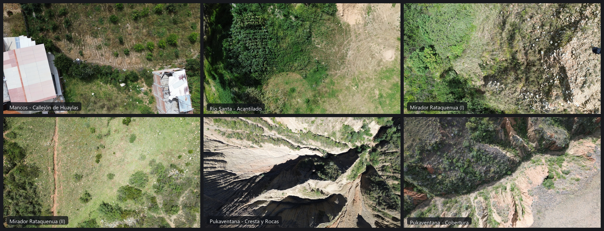

# Huaraz Drone Photogrammetry Dataset (DronFDataset)

Este repositorio es un proyecto personal creado para compartir de manera **libre y gratuita** fotografías aéreas capturadas con dron en diversos sectores de **Huaraz y el Callejón de Huaylas (Áncash, Perú)**, orientadas principalmente a fotogrametría, modelado 3D, análisis de relieve e investigación.

---

## Muestra Visual del Dataset

A continuación se presenta un collage de muestra con tomas características de los diferentes vuelos:

---

## Acceso y Descarga de los Datos

Todos los archivos originales (imágenes en JPG y RAW DNG, metadatos y fichas de vuelo) se encuentran alojados y disponibles para descarga pública en la carpeta de OneDrive:

🔗 **[Acceder a la carpeta completa en OneDrive (02-fotogrametria)](https://1drv.ms/f/c/775ea667c6078644/IgA0zRPqPnICS7I6zHyfcW4lAW3IJ7n-vKL2WvPaw1cfGQg?e=bbgXVT)**

---

## Equipo y Especificaciones Técnicas

| Parámetro | Detalle |
| :--- | :--- |
| **Dron** | DJI Mini 3 |
| **Cámara** | Sensor 1/1.3" CMOS, lente 24 mm f/1.7 |
| **Resolución** | 4000 × 2250 px (16:9) |
| **Formatos disponibles** | JPEG y RAW (DNG) con geotagging GPS integrado |
| **Software de control de vuelo** | DroneLink Elite (misiones automatizadas en cuadrícula / grid) |
| **Zona geográfica** | Huaraz, Mancos y alrededores (Cordillera Blanca / Negra, Perú) |

---

## Misiones y Conjuntos de Datos Incluidos

| Carpeta / Misión | Ubicación | Fecha | N° Fotos | Formatos | Descripción |
| :--- | :--- | :---: | :---: | :---: | :--- |
| **`ING-01-20260430`** | Virgen de Fátima (Huaraz) | 30/04/2026 | 130 | JPG + DNG | Margen del Río Santa, terreno baldío y acantilado con erosión activa. |
| **`MNC-01-20260501`** | Mancos (Yungay) | 01/05/2026 | 98 | JPG + DNG | Zona agrícola semipoblada en el Callejón de Huaylas. |
| **`RTQ-01-20260405`** | Mirador Rataquenua (Huaraz) | 05/04/2026 | 90 | JPG | Colinas y laderas con vegetación andina y vista panorámica. |
| **`RTQ-02-20260405`** | Mirador Rataquenua (Huaraz) | 05/04/2026 | 53 | JPG | Área de senderos y crestas en Rataquenua. |
| **`PKV-01-20260517`** | Pukaventana (Huaraz) | 17/05/2026 | 182 | JPG + DNG | Formaciones rocosas, crestas y relieve escarpado. |
| **`PKV-02-20260517`** | Pukaventana (Huaraz) | 17/05/2026 | 54 | JPG + DNG | Sector complementario de crestas en Pukaventana. |
| **`PKV-03-20260524`** | Pukaventana (Huaraz) | 24/05/2026 | 309 | JPG + DNG | Misión amplia de alta cobertura sobre formaciones geológicas. |

---

## Licencia y Uso

Estas imágenes son de autoría personal y se comparten de forma gratuita y abierta para fines educativos, académicos, investigación científica, experimentación con software de fotogrametría (OpenDroneMap, Agisoft Metashape, RealityCapture, etc.) o uso personal.
